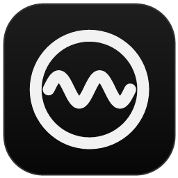
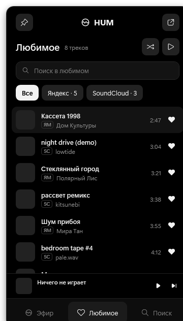
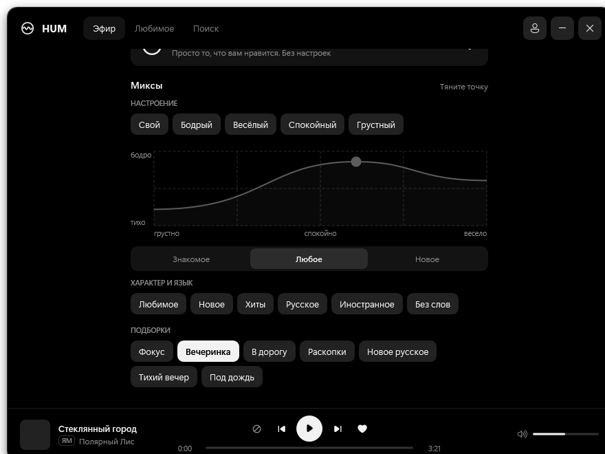
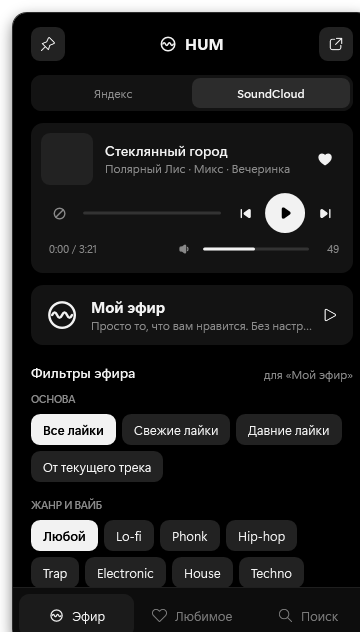
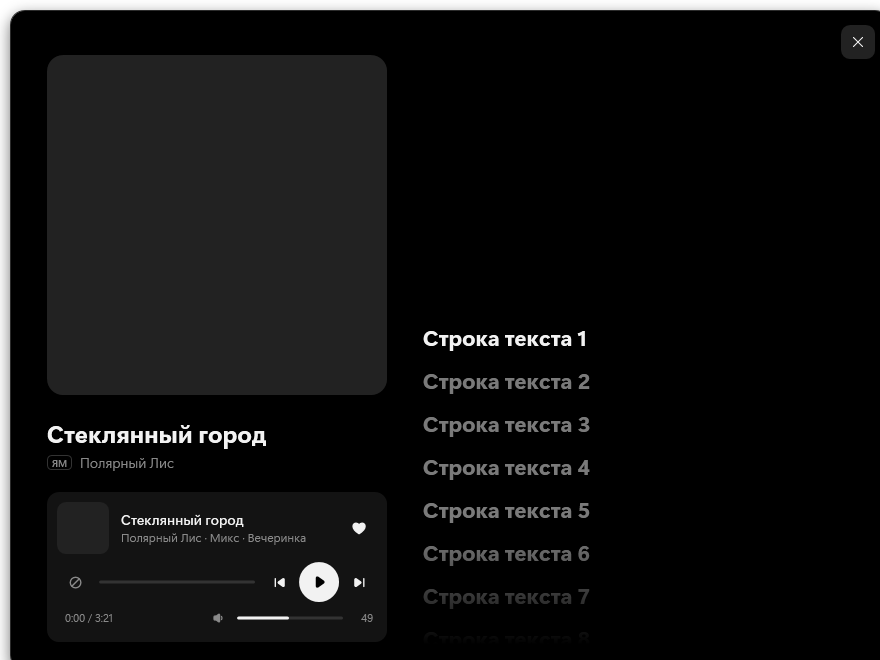

<p align="center"></p>

<h1 align="center">HUM</h1>

<p align="center">Музыкальный мини-плеер для трея Windows: Яндекс Музыка и SoundCloud в одном месте.</p>

<p align="center">
  
  
</p>

## Что умеет

- **Живёт в трее.** Клик по иконке открывает флайаут, двойной клик открывает большое окно, средняя кнопка мыши ставит паузу.
- **«Мой эфир».** Личная бесконечная волна в один клик, без настроек. Для Яндекса HUM отправляет сервису отметки «дослушал / пропустил / не нравится», поэтому рекомендации учатся так же, как в официальном приложении.
- **Миксы для Яндекса:**
  - настроение задаётся графиком: тянете точку от «грустно» к «весело» и от «тихо» к «бодро»;
  - готовые миксы: Бодрый, Весёлый, Спокойный, Грустный, Любимое, Новое, Хиты, Русское, Иностранное, Без слов;
  - подборки: Фокус, Вечеринка, В дорогу, Раскопки и другие;
  - «Занятия», которые отдаёт сам сервис.
- **Эфир для SoundCloud** собирается из похожих треков. Фильтры:
  - основа: все лайки, свежие лайки, давние лайки или текущий трек;
  - жанр (Lo-fi, Phonk, House, Techno, Drum & Bass и др.);
  - «без длинных сетов», «только незнакомое», «свежее за год».
- **Общее «Любимое».** Лайки из обоих сервисов собраны в один список. У каждого трека пометка `ЯМ` или `SC`, есть фильтр по сервису и поиск.
- **Поиск песен** в выбранном сервисе. Лайк из результатов сразу попадает в «Любимое».
- **Обложка и текст.** Клик по обложке открывает её крупно вместе с текстом песни, если сервис его отдаёт. Синхронизированный текст подсвечивает текущую строку, клик по строке перематывает трек.
- **Активность в Discord:** «Слушает HUM» с обложкой, исполнителем и полосой времени.
- **Медиаклавиши и системная плашка Windows** работают через системный плеер.

<p align="center">
  
  
</p>

## Требования

- Windows 10 (19041+) или Windows 11
- [.NET 8 SDK](https://dotnet.microsoft.com/download/dotnet/8.0)
- Microsoft Edge WebView2 Runtime (на Windows 11 уже установлен), нужен для входа в аккаунты
- Для полного прослушивания Яндекс Музыки нужна подписка Плюс

## Сборка и запуск

```bash
git clone https://github.com/qDoza/hum.git
cd hum
dotnet run --project src/Hum.App -c Release
```

Готовую копию можно собрать в отдельную папку:

```bash
dotnet publish src/Hum.App -c Release -o "%LOCALAPPDATA%\Programs\HUM"
```

## Первый запуск

1. На вкладке «Эфир» нажмите **«Подключить»**. Откроется встроенное окно входа Яндекс ID или SoundCloud, после входа оно закроется само.
2. Переключатель **Яндекс | SoundCloud** вверху выбирает сервис для эфира и поиска.
3. Остальные аккаунты и Discord настраиваются кнопкой с человечком в шапке окна.

### Discord

Discord показывает активность только от зарегистрированного приложения:

1. Создайте приложение на [discord.com/developers](https://discord.com/developers/applications) и назовите его **HUM**. Это имя Discord покажет после «Слушает».
2. Скопируйте **Application ID** и вставьте его в HUM: кнопка с человечком → «Активность в Discord».

## Где хранятся данные

- Токены и настройки: `%APPDATA%\Hum\settings.json`. Они только на вашем компьютере и в репозиторий не попадают.
- Лог: `%LOCALAPPDATA%\Hum\log.txt`. Его стоит приложить, если что-то не работает.

## Устройство

Стек: C# / WPF на .NET 8. Воспроизведение идёт через `Windows.Media.Playback`, вход через WebView2. Внешних зависимостей, кроме WebView2, нет.

| Путь | Что там |
|---|---|
| `Services/YandexClient.cs` | аккаунт, лайки, поиск, сессии «Моей волны», потоки, тексты |
| `Services/SoundCloudClient.cs` | api-v2: лайки, поиск, похожие треки, потоки |
| `Services/Library.cs` | оба аккаунта и общее «Любимое» |
| `Services/PlayerService.cs` | очередь, эфиры, миксы и фильтры, медиаклавиши |
| `Services/DiscordPresence.cs` | Rich Presence через локальный IPC Discord |
| `FlyoutWindow`, `MainWindow`, `UI/` | флайаут из трея, окно и страницы |

## Отказ от ответственности

HUM — неофициальный проект, он не связан с Яндексом и SoundCloud и ими не одобрен. Приложение пользуется теми же API, что и официальные клиенты: внутренним API Яндекс Музыки и веб-API SoundCloud. В любой момент они могут измениться, и что-то перестанет работать. Музыка и тексты берутся из сервисов под вашим аккаунтом и на диск не сохраняются. Пользуйтесь в соответствии с правилами этих сервисов.
